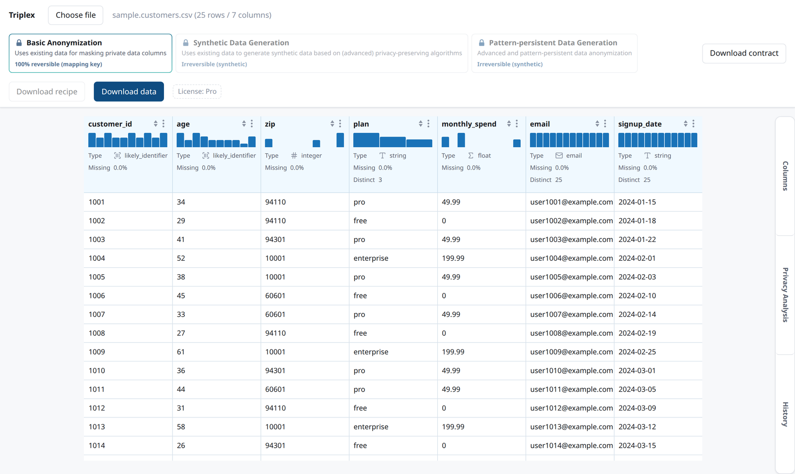

# Triplex

[](https://github.com/triplexanalytics/triplex/actions/workflows/ci.yml)
[](https://github.com/triplexanalytics/triplex/tags)
[](https://github.com/triplexanalytics/triplex/tags)
[](LICENSE)

Local-first data privacy tooling: schema contracts, pseudonymization, synthetic data,
privacy-risk scoring and drift checks. Everything runs inside your own perimeter: on your
machine, in your CI, or in your browser through WebAssembly.



## Your data stays with you

Triplex does not send your data anywhere. There is no server, no upload and no telemetry.
Datasets, identifiers, mapping files, credentials and profiling outputs stay where you run the
tool. The web UI reads your file inside the browser tab and never transmits it.

## What is in the box

All products share one Rust engine with Arrow-compatible data contracts.

| Product | What it does | Status |
|---|---|---|
| **SchemaCast** | Schema inference, `.triplex.yaml` contracts, validation, pattern checks, format conversion | Available |
| **Anonymizer** | Pseudonymization with a separate mapping file (Tier 1). Synthetic data from a Gaussian copula, a Bayesian network or independent marginals, optionally differentially private (Tier 2). Sketch-based synthesis you steer on parallel coordinates (Tier 3) | Tier 1 and Tier 2 available, Tier 3 in early form |
| **DatasetCard** | Privacy-risk scoring per dataset, column and record: k-anonymity, l-diversity, t-closeness and related models | Available |
| **DriftGuard** | Schema-regression and statistical-drift check between a baseline and a candidate, built for CI | Available |
| **ModelCard** | Fairness and slice metrics for a binary classifier, from a predictions file | First version available |

What the output is, and is not:

- **Pseudonymized output is still personal data.** The mapping file can reverse it.
- **Synthetic output carries no privacy guarantee by default.** Every run writes a report that
  states what was measured and what is not covered.
- **The differentially private mode is implemented and tested, and is awaiting independent
  review.** Treat its guarantee as unverified until that review is published.
- **ModelCard reports are not a conformity assessment.**

## Quick start

You need a stable [Rust toolchain](https://rustup.rs). The examples use the synthetic fixtures in
`tests/fixtures/`.

```sh
# Build the `triplex` binary into target/release/
cargo build --release -p triplex-cli
alias triplex=target/release/triplex
triplex --version

# Infer a schema from a file
triplex schema tests/fixtures/sample.csv

# Validate a file against a contract (exit code 0 on a match, 2 on a breach)
triplex validate --schema tests/fixtures/sample.contract.yaml --input tests/fixtures/sample.csv

# Pseudonymize a column. The salt is read from an environment variable, never from a file.
mkdir -p out
TRIPLEX_DEMO_SALT=change-me triplex anonymize \
  --recipe tests/fixtures/sample.anonymize.yaml \
  --input tests/fixtures/sample.csv \
  --output out/anonymized.csv --mapping-out out/mapping.csv

# Compare a candidate file against a baseline
# (exit code 0 for no drift, 1 for statistical drift, 2 for a schema regression)
triplex driftguard \
  --baseline tests/fixtures/driftguard.baseline.csv \
  --candidate tests/fixtures/driftguard.candidate.csv \
  --out-dir out/drift
```

Run `triplex` without arguments for the full command list, including `convert`,
`check-patterns`, `synthesize`, `modelcard` and `reveal-mapping`. Commands that produce a report
write three files: a deterministic audit JSON, a standalone offline HTML report and a Python
script that reproduces the numbers with Polars.

## Docker

```sh
docker build -t triplex .
docker run --rm --network none --user "$(id -u):$(id -g)" -v "$PWD:/data" \
  triplex schema tests/fixtures/sample.csv
```

The image holds only the `triplex` binary and runs as a non-root user. `--network none` lets
Docker enforce what the tool already does: it makes no network request. `--user` makes the
output files belong to you. Add `--build-arg TRIPLEX_VERSION=<version>` to set what
`triplex --version` reports.

## Web UI

The same engine compiled to WebAssembly, with a table view, per-column anonymization and risk
analysis. The Synthesize and Sketch dialogs are part of Triplex Pro, a paid extension; synthetic
data is available in the CLI and the Python package.

```sh
make -C apps/triplex-web setup   # one time: wasm target, wasm-bindgen CLI, npm dependencies
make -C apps/triplex-web dev     # build the wasm and start the dev server
```

See [apps/triplex-web/README.md](apps/triplex-web/README.md) for the build steps behind these
targets. The UI also runs as a Jupyter widget:
[packages/triplex-jupyter](packages/triplex-jupyter/README.md).

## Python

The engine also runs in plain Python, with no browser and no subprocess:

```python
import triplex

schema = triplex.infer_schema("tests/fixtures/sample.csv")
run = triplex.synthesize("tests/fixtures/sample.customers.csv", rows=1000, seed=1)
```

It is built from source for now. See [packages/triplex-python](packages/triplex-python/README.md).

## Documentation

Guides, the glossary and the evaluation of each product are on
[triplexanalytics.io/docs](https://triplexanalytics.io/docs/).

## Repository layout

| Path | Contents |
|---|---|
| `crates/triplex-core`, `crates/triplex-io` | Shared platform: data contracts and file formats |
| `crates/triplex-schemacast`, `-anonymizer`, `-datasetcard`, `-driftguard`, `-modelcard` | One crate per product |
| `apps/triplex-cli` | The `triplex` command-line tool |
| `apps/triplex-web` | WebAssembly bindings (`src/`) and the React UI (`www/`) |
| `apps/triplex-mcp` | Local MCP server over SchemaCast, stdio only |
| `packages/triplex-python` | Python bindings: `import triplex` |
| `packages/triplex-jupyter` | The web UI as a Jupyter widget |
| `tests/fixtures/` | Synthetic test data only |

## Development

```sh
cargo fmt --all -- --check
cargo clippy --workspace --all-targets -- -D warnings
cargo test --workspace
make -C apps/triplex-web test
(cd packages/triplex-python && pip install ".[dev]" && python -m pytest tests)
```

See [CONTRIBUTING.md](CONTRIBUTING.md) before opening an issue or a pull request, and
[SECURITY.md](SECURITY.md) for how to report a vulnerability.

## Versioning

Versions are git tags: `workspace-v*` for the engine and CLI, `web-v*` for the web UI, `python-v*` for the Python
package and `jupyter-v*` for the Jupyter widget. The
`version` fields in `Cargo.toml`, `package.json` and `pyproject.toml` are placeholders. Notable changes are listed
in [CHANGELOG.md](CHANGELOG.md).

## License

Apache-2.0. See [LICENSE](LICENSE) and [NOTICE](NOTICE).
